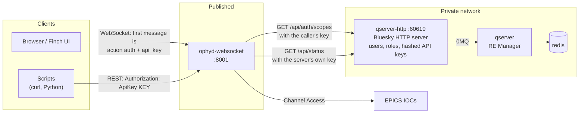
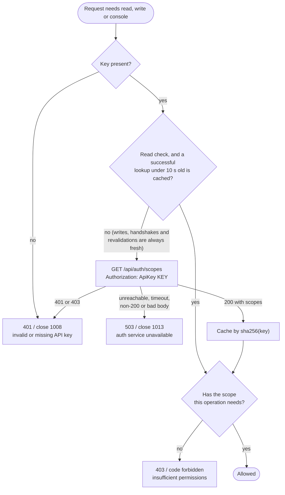
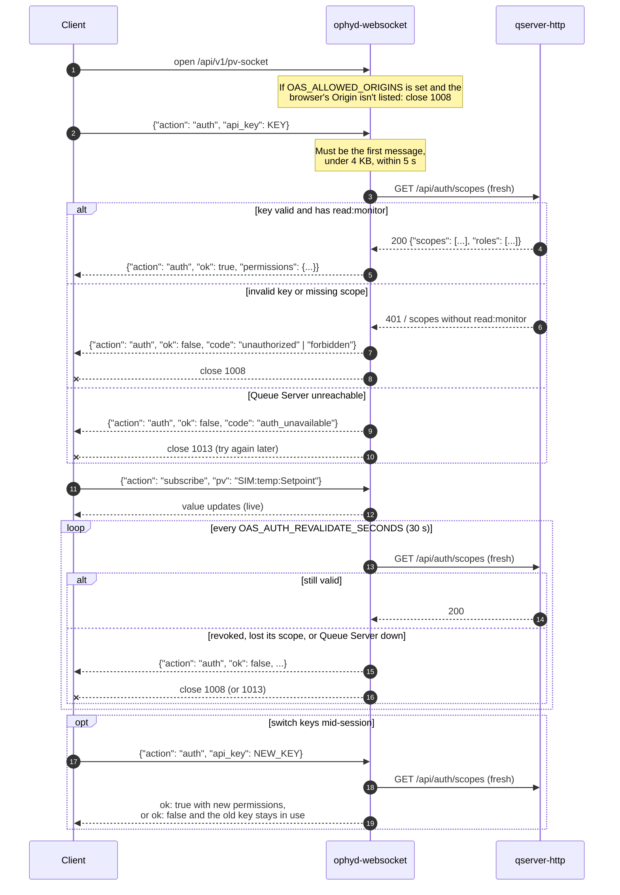
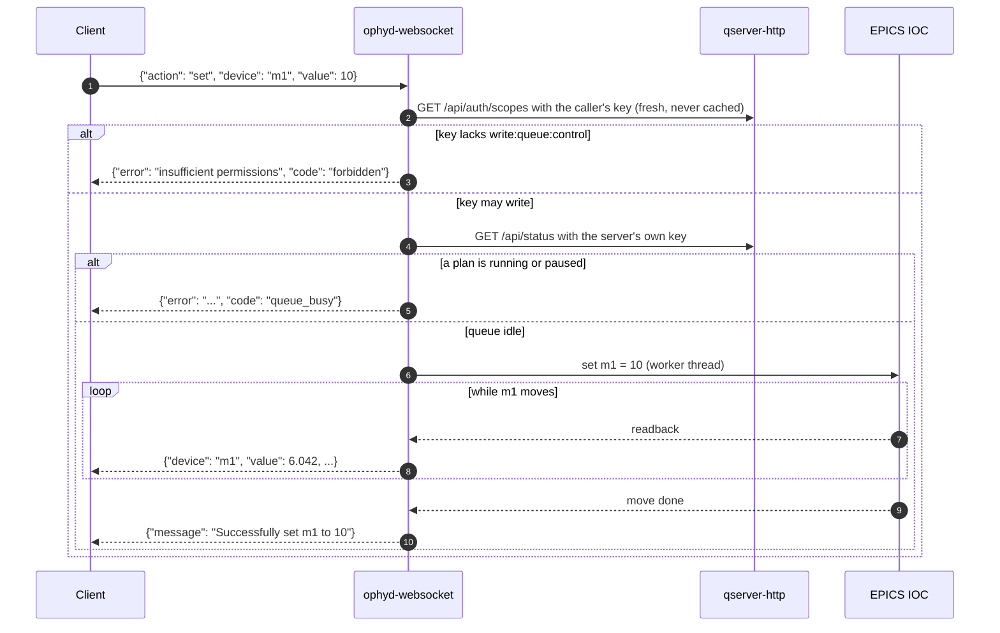

# How authentication works

This page explains how ophyd-websocket's API-key auth works, with diagrams.
For setup (environment variables, curl examples, using it from Finch), see the
[Authentication section of the README](../README.md#authentication). To run it
locally, see [`docker-compose-auth.yml` in DEVELOPMENT.md](../DEVELOPMENT.md#with-authentication-docker-compose-authyml).

Auth is **off by default** and turned on with `OAS_AUTH_ENABLED=true`.
Everything below describes the server with auth on.

- [Who decides what a key can do](#who-decides-what-a-key-can-do)
- [Checking a key](#checking-a-key)
- [What each scope allows](#what-each-scope-allows)
- [WebSocket lifecycle](#websocket-lifecycle)
- [Writes](#writes)
- [When auth is off](#when-auth-is-off)
- [Where it lives in the code](#where-it-lives-in-the-code)

## Who decides what a key can do

ophyd-websocket stores no users, passwords or keys. The **Bluesky Queue Server
HTTP server** owns them. A client presents the API key it already uses for the
Queue Server, and ophyd-websocket asks the Queue Server what that key may do.
One key works for both servers, so there's no second login.

The server makes two kinds of calls to the Queue Server, with **different
keys**:

| Call | Key used | Purpose |
|---|---|---|
| `GET /api/auth/scopes` | the **caller's** key | Find out what this caller may do |
| `GET /api/status` | ophyd-websocket's **own** key, `QSERVER_HTTP_SERVER_SINGLE_USER_API_KEY` | Queue-safety check: refuse writes while a plan runs |

The user's key is never used for the status check, and the server's key is
never used to decide what a user may do.

> **Auth protects this server, not the IOCs.** Anyone who can reach the IOCs
> over Channel Access can still `caput` directly. Keep the IOC network
> private; this auth gates the WebSocket/REST path to it.

## Checking a key

Every request, and every socket handshake, goes through the same check,
`authorize()` in `auth.py`. It **fails closed**: if the Queue Server can't
answer, or answers with something unexpected, the request is refused.

Details worth knowing:

- **Effective scopes.** The Queue Server reports the key's own scopes
  intersected with its owner's role scopes. An operator key minted with
  restricted scopes gets only those. Permissions come from scopes, never from
  role names.
- **The cache** keys entries by sha256 of the API key, never the key itself.
  It stores only successful lookups, and only read checks use it.
- **Keys are never logged.** Logs show an 8-character sha256 fingerprint.
  Keys in a URL are ignored; REST takes them only from the
  `Authorization: ApiKey …` (or `Bearer …`) header.

## What each scope allows

| Operation | Scope (default) | Override with | Observer | Operator |
|---|---|---|---|---|
| REST GETs, `POST /pvs/{pv}`, subscribe and refresh on pv-/device-socket, camera and TIFF streams | `read:monitor` | `OAS_AUTH_READ_SCOPE` | yes | yes |
| `PUT /pvs`, `PUT /devices`, `POST /load-devices`, the socket `set` action | `write:queue:control` | `OAS_AUTH_WRITE_SCOPE` | **no** | yes |
| `/qs-console-socket` | `read:console` | `OAS_AUTH_CONSOLE_SCOPE` | yes | yes |

Always public: `GET /`, `GET /api/v1/websockets`, `/docs`, `/openapi.json`.

A UI can call `GET /api/v1/auth/permissions` (or read `permissions` from the
socket's auth reply) to hide write controls. That is advisory: the server
checks every write itself.

## WebSocket lifecycle

Browsers can't set headers on a WebSocket, so the key goes in the **first
message**. Nothing is subscribed, and no camera or TIFF worker starts, until
that message is accepted. An open socket then rechecks its key in the
background for as long as it stays open.

**Close codes.** `1008` (policy violation) means the client must fix
something: a bad key, a missing scope, or a malformed or late auth message.
`1013` (try again later) means the Queue Server couldn't be asked, so
reconnecting later can succeed.

**Revocation timing.** Writes notice a revoked key immediately, because every
write is checked fresh. An open socket keeps reading until its next
revalidation, up to `OAS_AUTH_REVALIDATE_SECONDS` (30 s). Over REST, a read
can reuse a cached check for up to `OAS_AUTH_READ_CACHE_SECONDS` (10 s).

**Camera and TIFF sockets** expect an init message after auth (for example
`{"prefix": "SIMTIFF1"}`). An `auth` message sent before the init message is
acknowledged and skipped, so clients can always authenticate first.

## Writes

A socket `set` passes two gates before anything is written to EPICS. The
write itself then runs in the background, so readbacks keep streaming while a
motor moves and the socket can accept a new target mid-move.

- **No default timeout.** `set` waits for the move to finish unless the
  client sends a `timeout`. If that runs out, the reply says the device may
  still be moving: ophyd stops waiting, not the motor.
- **REST writes** (`PUT /pvs`, `PUT /devices`) pass the same two gates and
  answer `403` or `423 Locked` instead of a `code`. `POST /load-devices`
  needs the write scope but skips the queue-safety check.
- **Two Queue Server round trips per write.** Every write checks the key
  fresh, then checks queue status, so a write starts a little after it is
  sent. That's the price of revoking keys immediately.
- **`OAS_REQUIRE_QSERVER`** decides what the queue-safety check does when the
  Queue Server is unreachable: `true` refuses the write, `false` allows it.
  It never affects the key check, which always fails closed.
- `/pv-socket` sends nothing on a successful `set`; it reports only failures.
  `/device-socket` confirms success.

## When auth is off

With `OAS_AUTH_ENABLED` unset or `false`:

- No request needs a key, and the server logs a warning at startup.
- An `auth` message on a socket is acknowledged with full permissions, so one
  client works against servers with auth on or off.
- **Sockets make no Queue Server calls at all**, not even the queue-safety
  check on `set`. REST writes still run the queue-safety check.

## Where it lives in the code

| What | Where |
|---|---|
| Key lookup, caching, scope mapping, error types and close codes | `src/ophyd_websocket/auth.py`: `authorize()`, `fetch_principal()` |
| REST dependencies | `auth.py`: `require_read`, `require_write`, `require_console` |
| Socket handshake, revalidation, key switching | `auth.py`: `authenticate_websocket()`, `WsAuthSession` |
| Per-write gate on sockets | `auth.py`: `authorize_ws_write()` |
| Queue-safety check | `src/ophyd_websocket/queue_safety.py` |
| Background writes | `src/ophyd_websocket/writes.py` |
| Users, roles and their scopes | `qserver/config.auth.yml` |
| Tests | `src/tests/test_auth.py` |
